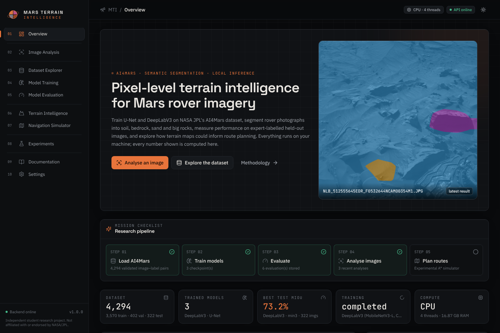
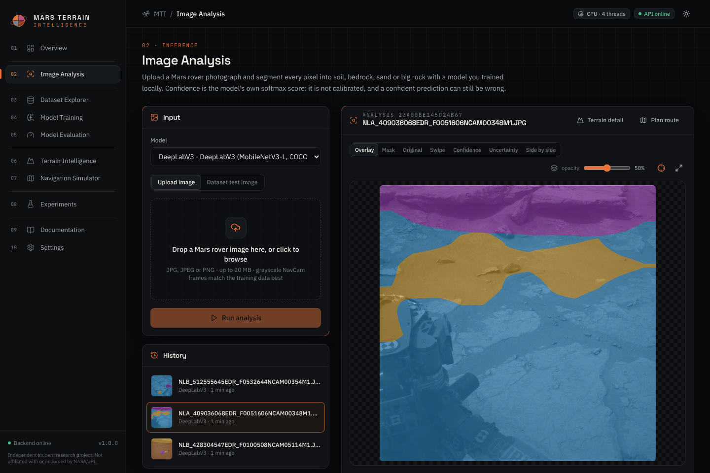
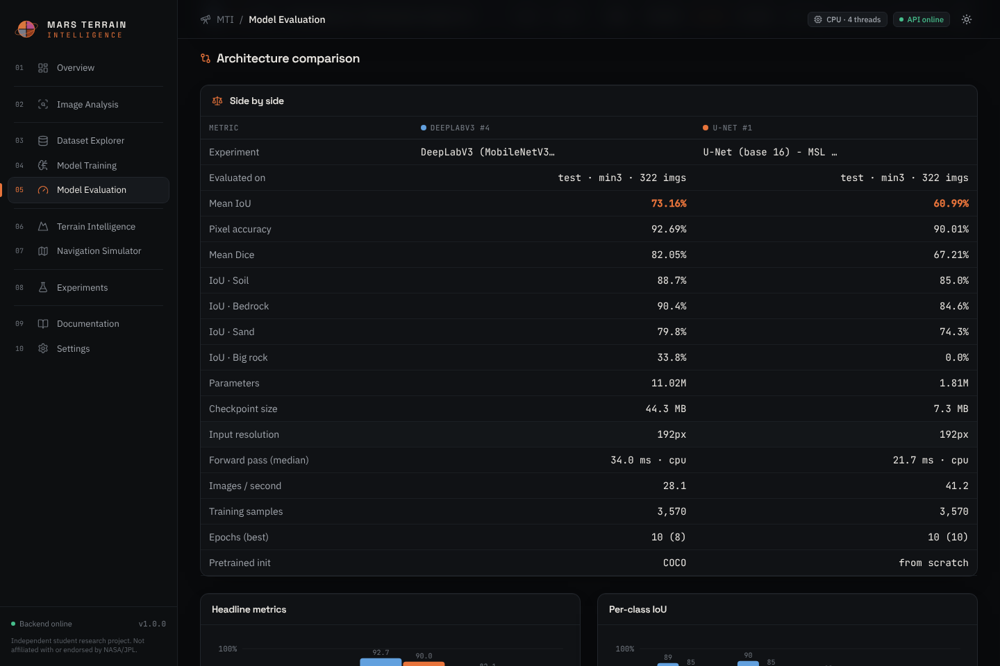
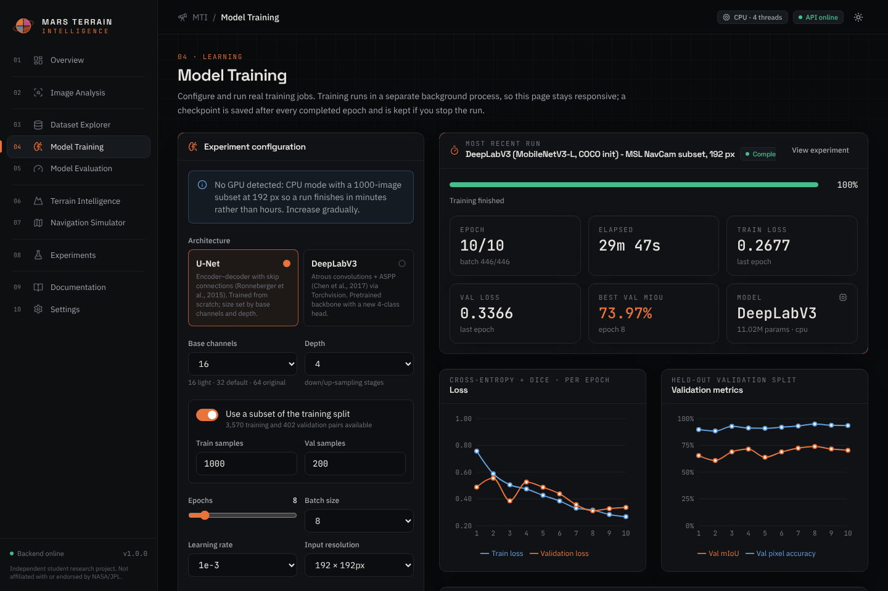
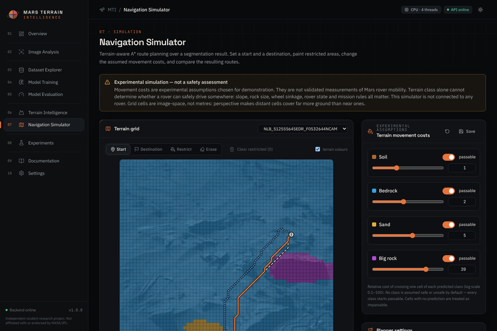

# Mars Terrain Intelligence

**AI-powered Mars rover terrain segmentation, analysis and navigation simulation — runs entirely on your own computer.**

Train U-Net and DeepLabV3 on NASA JPL's **AI4Mars** dataset, classify every pixel of a rover photograph as
**soil, bedrock, sand or big rock**, score the models on expert-labelled held-out images, explore the terrain
statistics, and experiment with terrain-aware A\* route planning — all through a web interface.

> Independent student research and engineering project. It is **not** an official NASA system, is not endorsed by
> NASA/JPL, and has never been connected to or deployed on a rover. No paid APIs or external AI services are used:
> every model is trained and run locally, and every number in the interface is computed by this application.



---

## Contents

1. [What you can do](#what-you-can-do)
2. [Quick start on Windows](#quick-start-on-windows)
3. [Quick start on macOS / Linux](#quick-start-on-macos--linux)
4. [Manual start (any OS)](#manual-start-any-os)
5. [Your first session, step by step](#your-first-session-step-by-step)
6. [Testing](#testing)
7. [Results](#results)
8. [Project structure](#project-structure)
9. [Configuration](#configuration)
10. [REST API](#rest-api)
11. [Troubleshooting](#troubleshooting)
12. [Scientific notes, limitations and citation](#scientific-notes-limitations-and-citation)

---

## What you can do

| # | Page | What it does |
|---|------|--------------|
| 01 | **Overview** | Live status of dataset, models, training and evaluations; latest segmentation; a step-by-step research checklist. Empty states explain how to begin. |
| 02 | **Image Analysis** | Drag-and-drop a JPG/PNG (or pick an expert-labelled test image), choose a trained model, run local inference. Mask, transparent overlay with opacity control, **swipe comparison**, side-by-side panel, confidence and uncertainty maps, a **pixel inspector** (hover to read class + confidence), terrain distribution, downloads. |
| 03 | **Dataset Explorer** | Download a chosen subset straight from Zenodo, the full archive, or import a local ZIP. Validation report, class distribution per split, unlabelled-pixel share, test-label variants, leakage check, folder structure, and an image/mask gallery where you can compare ground truth with a model's prediction. |
| 04 | **Model Training** | Configure U-Net or DeepLabV3 (size, epochs, batch, learning rate, resolution, subset, device, loss, schedule…). A **measured** workload estimate is required before starting. Training runs in the background with pause / resume / stop, live loss and validation curves, per-class IoU and a log console. |
| 05 | **Model Evaluation** | Evaluate on the official expert test set (min1 / min2 / min3 agreement) or the validation split. Pixel accuracy, mIoU, Dice, per-class IoU / precision / recall, confusion matrix, inference time, model size; **side-by-side architecture comparison**; CSV/JSON reports. |
| 06 | **Terrain Intelligence** | Dominant class, composition, 3×3 frame zones, near-to-far band profile, connected regions, confidence distribution and an uncertainty (entropy) map. |
| 07 | **Navigation Simulator** | A\* over the segmentation grid. Click start/destination, paint restricted cells, set per-class costs or mark classes impassable, add an uncertainty penalty; compare the terrain-aware route with a terrain-blind shortest route and an alternative corridor. Clearly labelled as an experimental simulation. |
| 08 | **Experiments** | Every run (including stopped/failed ones) stored in SQLite: configuration, curves, evaluations, notes, comparison of several runs, downloadable reports. |
| 09 | **Documentation** | Architecture, dataset, models, training and evaluation methodology, navigation assumptions, limitations, references, and live results. |
| 10 | **Settings** | Backend status, hardware diagnostics, storage paths, theme (dark/light), class colours (with a colour-blind-safe preset; class ids never change). |

<table>
<tr><td></td><td></td></tr>
<tr><td></td><td></td></tr>
</table>

---

## Quick start on Windows

**You need:** Windows 10/11, [Python 3.10 – 3.12](https://www.python.org/downloads/) (tick *“Add python.exe to PATH”*),
[Node.js 18+ LTS](https://nodejs.org/), [Git](https://git-scm.com/), about 3 GB of free disk for the software plus
1.5 GB for a 4,000-image dataset subset. An NVIDIA GPU is optional (detected automatically).

Open **PowerShell** in a folder of your choice:

```powershell
git clone https://github.com/aarushagrawal267-maker/AI4Mars.git
```

```powershell
cd AI4Mars
```

If Windows blocks scripts, allow them for this PowerShell window only:

```powershell
Set-ExecutionPolicy -Scope Process -ExecutionPolicy Bypass
```

Install everything (Python virtual environment, PyTorch — CUDA build if an NVIDIA GPU is found, otherwise CPU —
backend and frontend packages, folders, database, hardware check):

```powershell
.\setup.ps1
```

Start the app (backend on http://localhost:8000, website on http://localhost:5173):

```powershell
.\start.ps1 -Open
```

Stop it:

```powershell
.\stop.ps1
```

`setup.ps1` options: `-CpuOnly` (force CPU PyTorch), `-Cuda` (force the CUDA build), `-WithE2E` (also install the
Playwright browser for end-to-end tests). Logs from `start.ps1` go to `.run\`.

## Quick start on macOS / Linux

```bash
./setup.sh
```

```bash
./start.sh
```

```bash
./stop.sh
```

## Manual start (any OS)

Backend (from the repository root, inside the virtual environment):

```bash
python -m venv .venv
```

```bash
.venv/bin/pip install -r requirements.txt          # Windows: .venv\Scripts\pip install -r requirements.txt
```

```bash
.venv/bin/python -m uvicorn backend.app.main:app --port 8000   # Windows: .venv\Scripts\python -m uvicorn ...
```

Frontend (second terminal):

```bash
cd frontend && npm install && npm run dev
```

Open http://localhost:5173. Interactive API documentation is at http://localhost:8000/docs.
An optional `docker compose up` route is described in `docker-compose.yml` (CPU only).

---

## Deploying online

**Streamlit Community Cloud (free):** `streamlit_app/streamlit_app.py` is a Streamlit edition that runs the trained
models (committed in `deploy/bundle/`) on the server: share.streamlit.io -> Create app -> this repository, branch
`main`, main file `streamlit_app/streamlit_app.py`. Dependencies come from `streamlit_app/requirements.txt` (CPU PyTorch).

**Public browser edition (free):** https://agrawalaarush08-mars-terrain-intelligence.static.hf.space
(published with `scripts/deploy_hf_static.py`).

**Try it without installing anything:** the *browser edition* runs the trained U-Net and DeepLabV3 inside your web
browser (WebAssembly via onnxruntime-web), with the real evaluation results, experiments, dataset statistics, 120
expert-labelled test images and the navigation simulator: https://claude.ai/artifact/MxTWBvkHmh2pq5HEQG36H6
(training and evaluation need the full app). Rebuild it with `python scripts/export_web_demo.py`, then
`cd frontend && VITE_DEMO=1 npx vite build && python ../scripts/finalize_web_demo.py`.

To publish the app at a public URL in read-only **demo mode** (visitors can analyse images and explore results;
training, evaluation and deletion need an admin token), follow [docs/deploy-render.md](docs/deploy-render.md)
for Render (Standard plan, 2 GB RAM needed) or use `scripts/deploy_hf_space.py` for a Hugging Face Docker Space (requires a Hugging Face PRO subscription).

---

## Your first session, step by step

1. **Load the dataset** — *Dataset Explorer → Download subset.* Pick the number of training pairs (3,000 ≈ 1.2 GB is a
   good laptop start) and click **Download & validate**. Only the Curiosity NavCam files you need are fetched from the
   verified Zenodo record, CRC-checked, then every image/label pair is validated and indexed. Already have the ZIP
   (from Zenodo or the Kaggle mirror)? Put it in `data\raw\imports\` and use **Import local ZIP**.
   Command-line alternative: `.venv\Scripts\python scripts\download_dataset.py --train-count 3000`.
2. **Train U-Net** — *Model Training.* The defaults adapt to your hardware (CPU: 1,000 images at 192 px).
   Click **Estimate workload** (it times real training steps on your machine), then **Start training**. Watch the curves;
   pause or stop at any time — finished epochs are always kept.
3. **Train DeepLabV3** with the *same* settings (only the architecture changes) for a fair comparison.
4. **Evaluate** — *Model Evaluation.* Evaluate each model on the **Test (expert)** split with the same agreement
   level (e.g. `min3`). Tick both rows to compare them side by side and download CSV/JSON reports.
5. **Analyse an image** — *Image Analysis.* Upload a rover photo (grayscale NavCam frames match the training data
   best; NASA's raw-image sites are a good source) or pick a test image, then explore it in *Terrain Intelligence*.
6. **Plan a route** — *Navigation Simulator.* Click a start and a destination, paint restricted cells, change costs.

**How long does training take?** Measured in this repository's development environment (4 CPU threads, no GPU),
at 192 px with batch size 8 on 3,570 training images: U-Net (base 16, 1.8 M parameters) took 3.5–5.5 minutes per
epoch (40 min for 10 epochs) and DeepLabV3-MobileNetV3 (11 M parameters) about 3 minutes per epoch (30 min). Each
test-set evaluation of 322 images took 2–4 minutes. Your laptop will differ — use the estimate button, which
measures your machine. A CUDA GPU is typically one to two orders of magnitude faster.

---

## Testing

| Suite | Command | What it covers |
|-------|---------|----------------|
| Python (68 tests) | `.venv\Scripts\python -m pytest` | Model shapes, 4-class output, ignore-index loss, checkpoints, inference, metrics vs scikit-learn, dataset validation, range-request download, A\* optimality, every API endpoint, database persistence, a real tiny training run |
| Frontend (15 tests) | `cd frontend` then `npm test` | Navigation, upload & validation, API errors, empty states, model selection, training controls, result rendering |
| End-to-end (3 tests) | `cd frontend` then `npx playwright install chromium` (once) and `npm run e2e` | Uploads an image in a real browser and verifies a valid segmentation; invalid uploads; every page loads |

Python tests use a small **synthetic** dataset generated on the fly, and the end-to-end test runs an isolated backend
on ports 8001/5174 with a temporary data folder. When no trained checkpoint exists the interface tests use a
deterministic, **untrained test fixture** model that is labelled “TEST FIXTURE · not a real prediction” everywhere —
its output is never presented as an AI prediction. Details: [docs/testing.md](docs/testing.md).

---

## Results

<!-- RESULTS:START -->
Baseline experiment run in this repository's development environment (4 CPU threads, no GPU) with
[`scripts/run_baseline_experiments.py`](scripts/run_baseline_experiments.py). Both models used **identical**
settings — 3,570 training / 402 validation images (Curiosity NavCam subset, seed 42), 192 × 192 px, batch 8,
10 epochs, AdamW lr 1e-3 with cosine schedule, cross-entropy (ignore 255) + 0.5 × Dice, same augmentation and seed —
only the architecture differs. The best checkpoint was selected on validation mIoU; the official expert test set
(322 images) was used only for these final measurements, at native 1024 × 1024 label resolution. All values below
were produced by the application and are reproducible with the scripts above; percentages are ×100.

<!-- TABLE:START -->
| Model | Split · labels | Images | Pixel acc. | mIoU | Mean Dice | IoU Soil | IoU Bedrock | IoU Sand | IoU Big rock | Forward pass (median) | Params | Checkpoint |
|---|---|---:|---:|---:|---:|---:|---:|---:|---:|---:|---:|---:|
| DeepLabV3 | test · min1 | 322 | 87.2 | **60.1** | 69.6 | 82.6 | 77.0 | 71.0 | 9.8 | 31.7 ms (cpu) | 11.02 M | 44.3 MB |
| U-Net | test · min1 | 322 | 84.4 | **53.9** | 62.6 | 77.9 | 74.1 | 63.4 | 0.0 | 23.2 ms (cpu) | 1.81 M | 7.3 MB |
| DeepLabV3 | test · min3 | 322 | 92.7 | **73.2** | 82.1 | 88.7 | 90.4 | 79.8 | 33.8 | 34.0 ms (cpu) | 11.02 M | 44.3 MB |
| U-Net | test · min3 | 322 | 90.0 | **61.0** | 67.2 | 85.0 | 84.6 | 74.3 | 0.0 | 21.7 ms (cpu) | 1.81 M | 7.3 MB |
| DeepLabV3 | validation | 402 | 94.9 | **73.9** | 81.5 | 91.5 | 92.6 | 83.9 | 27.5 | 29.8 ms (cpu) | 11.02 M | 44.3 MB |
| U-Net | validation | 402 | 91.7 | **62.1** | 67.9 | 86.5 | 88.3 | 73.9 | 0.0 | 23.0 ms (cpu) | 1.81 M | 7.3 MB |

| Experiment | Architecture | Epochs run (best) | Best val mIoU | Train / val images | Resolution | Wall time |
|---|---|---|---:|---|---|---:|
| DeepLabV3 (MobileNetV3-L, COCO init) - MSL NavCam subset, 192 px | DeepLabV3 {"backbone": "mobilenet_v3_large", "pretrained": "coco"} | 10/10 (8) | 74.0 | 3570 / 402 | 192 px | 30 min (cpu) |
| U-Net (base 16) - MSL NavCam subset, 192 px | U-Net {"base_channels": 16, "depth": 4, "bilinear": true, "dropout": 0.0} | 10/10 (10) | 62.2 | 3570 / 402 | 192 px | 40 min (cpu) |
<!-- TABLE:END -->

**What these numbers say — and don't**

- **DeepLabV3 beat U-Net on every split and every class** in this setting: test mIoU 73.2 vs 61.0 on `min3`
  labels and 60.1 vs 53.9 on `min1`. Part of that gap is the COCO-pretrained backbone (U-Net was trained from
  scratch) and DeepLabV3's 6× larger parameter count; the comparison is between the two *configurations*, not a
  claim about the architectures in general.
- **Big rock is the weak class.** U-Net never predicted it correctly (IoU 0.0); DeepLabV3 reached 33.8 (`min3`).
  Big rock is ~1.2 % of labelled training pixels and 0.07 % of `min3` test pixels, so these values rest on very few
  pixels. Class weighting (available in the training page) is the obvious next experiment.
- **`min1` scores are lower than `min3`.** `min1` labels include pixels where only one of three experts was
  confident; they are larger and contain harder, more ambiguous regions. Report both.
- **Validation and test agree.** Validation mIoU re-measured at native resolution (62.1 / 73.9) matches the value
  tracked during training (62.2 / 74.0), and test `min3` is close to validation — no sign of checkpoint-selection
  overfitting at this scale. DeepLabV3's validation mIoU fluctuated between epochs (64–74 %), so a single run
  carries noticeable variance; several seeds would be needed for a firm conclusion.
- **Speed** is the median single-image forward pass at 192 px on this CPU; U-Net is faster (21.7 vs 34.0 ms) and
  6× smaller on disk (7.3 vs 44.3 MB).
- **Limits:** one seed, a 22 % subset of the available training pairs, low resolution and 10 CPU epochs. With a GPU,
  the full 16,064 training pairs and higher resolution, both models should improve. 31 of the 322 test images share
  a rover position with the training subset (reported by the Dataset Explorer).
- **Known failure mode:** pixels the labels never cover (rover hardware, sky, terrain beyond ~30 m) still receive a
  class at inference — e.g. the rover body is often predicted as bedrock. Evaluation ignores those pixels; whole-image
  terrain percentages do not.
<!-- RESULTS:END -->

---

## Project structure

```
AI4Mars/
├── backend/app/         FastAPI app: api/ (routers), core/ (settings), database/ (SQLAlchemy/SQLite),
│                        schemas/, services/ (dataset, training manager, inference, evaluation, jobs), navigation/ (A*)
├── ml/                  Machine learning, independent of the web stack
│   ├── datasets/        source verification, remote-ZIP subset download, layout detection, index & validation, cache
│   ├── preprocessing/   image/label transforms, augmentation, upload validation
│   ├── architectures/   U-Net, DeepLabV3, model factory and checkpoint format
│   ├── training/        config, losses, trainer (separate process), workload estimate
│   ├── evaluation/      confusion-matrix metrics, held-out evaluation
│   └── inference/       predictor, terrain statistics, visualisation
├── frontend/            React + TypeScript + Vite + Tailwind + Recharts (src/pages, components, charts, services, …)
├── tests/               pytest suites (ml/, backend/)
├── scripts/             download_dataset.py, run_baseline_experiments.py
├── docs/                architecture, dataset, models, training, evaluation, navigation, limitations, references, testing
├── data/                (git-ignored) raw dataset, processed cache, analyses, SQLite database
├── checkpoints/         (git-ignored) best.pt / last.pt per experiment
├── experiments/         (git-ignored) per-run status, history and logs
├── setup.ps1 start.ps1 stop.ps1   Windows scripts      setup.sh start.sh stop.sh   macOS/Linux scripts
└── requirements.txt  .env.example  docker-compose.yml
```

Datasets, checkpoints, generated images and the database are never committed.

## Configuration

Copy `.env.example` to `.env` (setup does this) and adjust if needed — e.g. `MTI_DATA_DIR` to keep the dataset on
another drive, `MTI_MAX_UPLOAD_MB`, or `MTI_VAL_FRACTION`. Restart the backend after changes.

## REST API

All endpoints are under `/api` and documented interactively at http://localhost:8000/docs. Main ones:
`GET /health`, `GET /system/info`, `GET /dataset/status`, `POST /dataset/load`, `POST /dataset/download`,
`POST /dataset/import`, `GET /dataset/statistics`, `GET /dataset/validation`, `GET /dataset/samples`,
`GET /models`, `POST /training/estimate`, `POST /training/start`, `POST /training/pause|resume|stop`,
`GET /training/status`, `GET /training/logs`, `POST /predict`, `GET /analyses/{id}`, `POST /evaluate`,
`GET /evaluations`, `GET /evaluations/report`, `GET /experiments`, `GET /experiments/{id}`,
`POST /navigation/plan`, `GET|PUT /navigation/costs`, `GET|PUT /settings/colors`.
See [docs/architecture.md](docs/architecture.md) for the full list.

## Troubleshooting

| Problem | Fix |
|---------|-----|
| *“running scripts is disabled on this system”* | Run `Set-ExecutionPolicy -Scope Process -ExecutionPolicy Bypass` in that PowerShell window. |
| `python` opens the Microsoft Store | Install Python from python.org and tick *Add to PATH*, or use the `py` launcher (setup.ps1 tries `py -3` first). |
| Port 8000 or 5173 in use | `.\stop.ps1`, or close the other program. |
| Website shows *Backend unreachable* | Check `.run\backend.err.log`; start the backend with `.\start.ps1`. |
| Training fails with *Out of memory* | Lower batch size or resolution, or use U-Net base 16 / DeepLabV3-MobileNetV3. Finished epochs are kept. |
| DeepLabV3 says pretrained weights not loaded | The first run downloads COCO weights from download.pytorch.org; check your internet connection. The run continues from random initialisation and records that fact. |
| Zenodo download is slow or rate-limited | It resumes where it stopped — click download again. Or download the ZIP in a browser and use *Import local ZIP*. |

---

## Scientific notes, limitations and citation

- **Dataset:** AI4Mars merged v0.6 (Zenodo record [15995036](https://zenodo.org/records/15995036), CC-BY-4.0). This
  project uses the Curiosity NavCam subset: crowdsourced training labels and the official expert-labelled 322-image
  test set. Label encoding 0 soil · 1 bedrock · 2 sand · 3 big rock · 255 unlabelled was verified on the real files.
  Unlabelled pixels are excluded from the loss and from every metric. Train/validation are split by rover position to
  avoid near-duplicate leakage. See [docs/dataset.md](docs/dataset.md).
- **Fair comparison:** both architectures see the same split, preprocessing, resolution, batch size, epochs,
  optimiser, learning rate, loss, augmentation and seed; checkpoints are selected on validation mIoU only and the test
  set is used only for final evaluation. See [docs/training.md](docs/training.md).
- **Confidence is not accuracy:** displayed confidence is the softmax probability of the predicted class. Calibration
  has not been tested.
- **Navigation is a simulation:** costs are assumptions, cells are image-space (not metres), and terrain class alone
  cannot determine rover safety.
- **Known limitations** (class imbalance — big rock ≈1% of training pixels, crowdsourced/sparse labels, grayscale
  NavCam domain only, CPU-limited training, single seed): [docs/limitations.md](docs/limitations.md).

If you use this work, please cite the dataset and paper:

> R. M. Swan, D. Atha, H. A. Leopold, M. Gildner, S. Oij, C. Chiu, M. Ono. *AI4Mars: A Dataset for Terrain-Aware
> Autonomous Driving on Mars.* CVPR Workshops, 2021. Dataset: doi:10.5281/zenodo.15995036.

Full reference list: [docs/references.md](docs/references.md).
